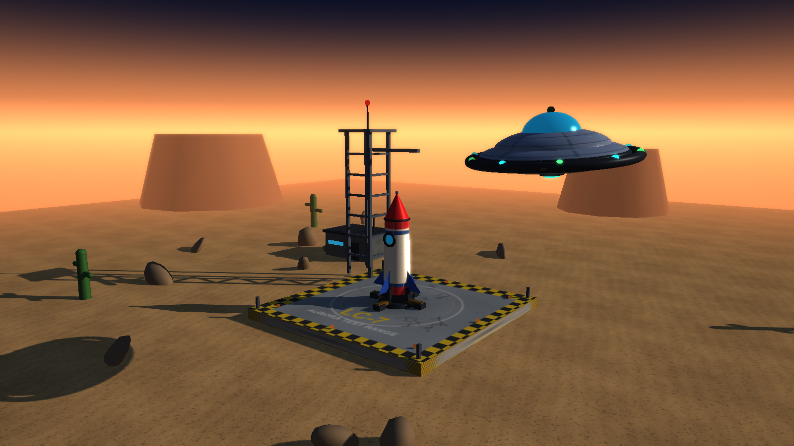
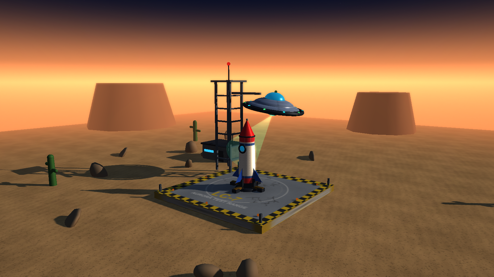
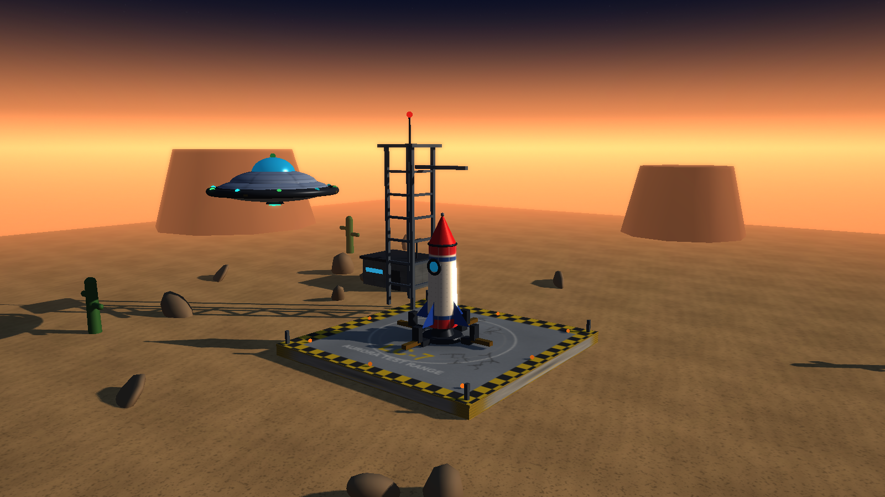
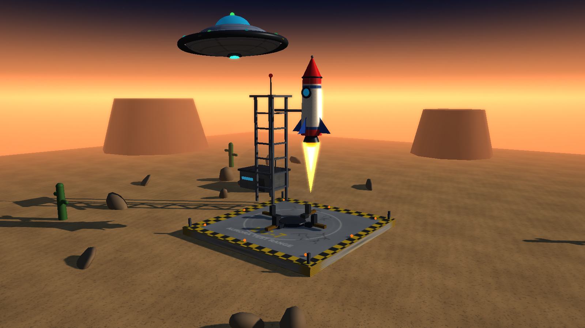
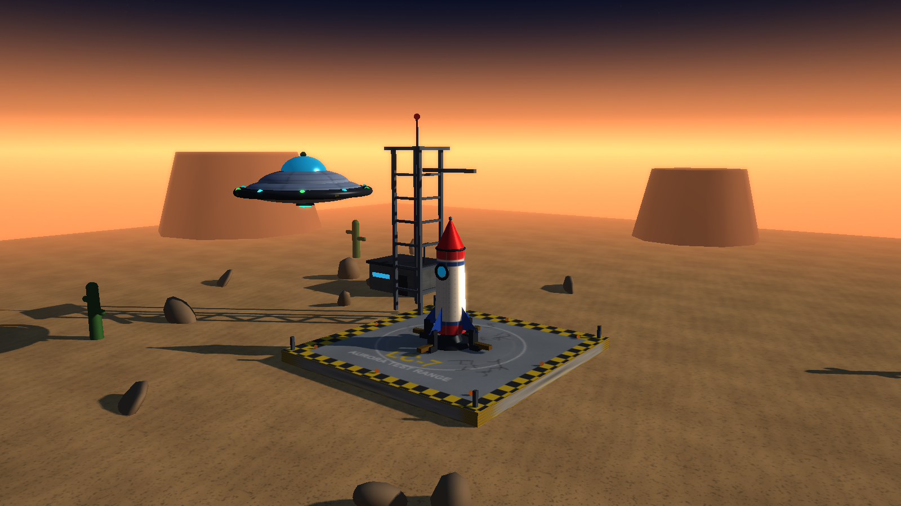
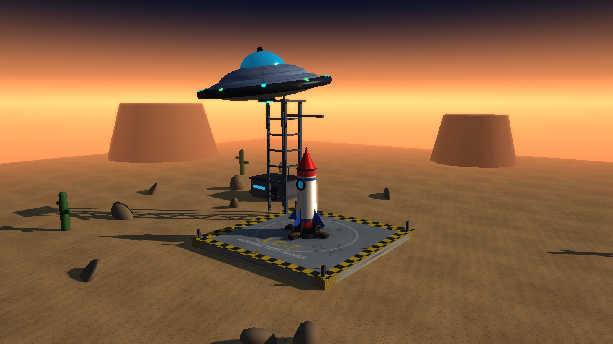
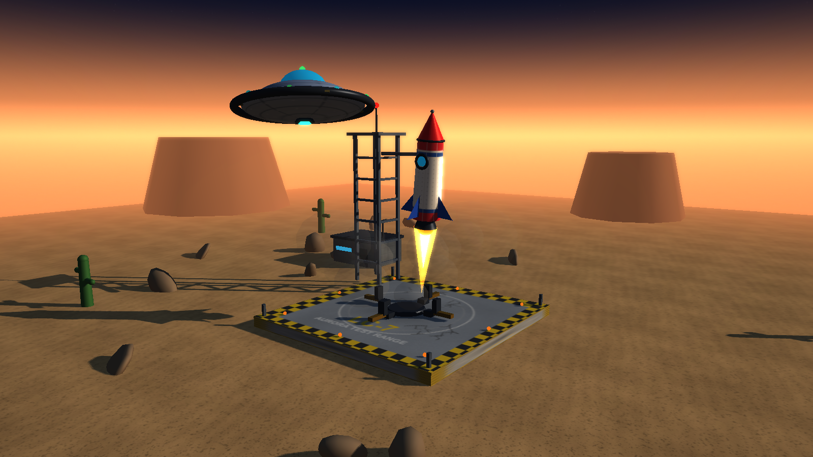
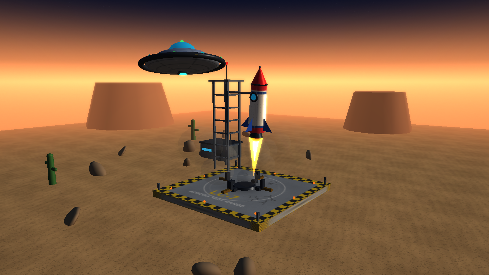
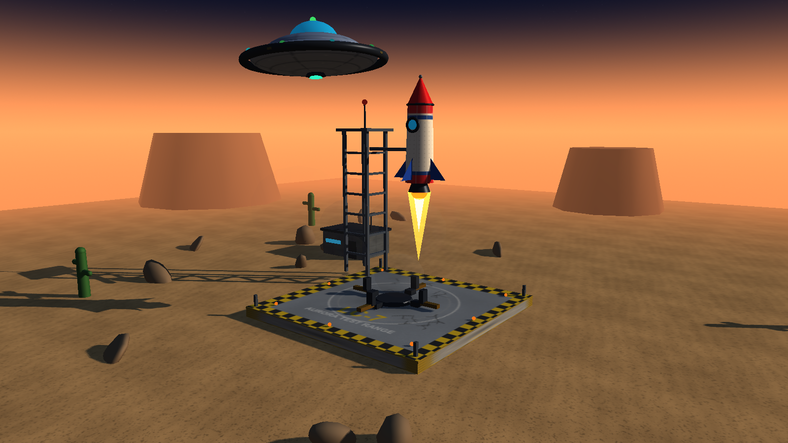

# Base Aurora — Disco Voador + Foguete

Trabalho prático de Computação Gráfica — 2026/02

**Tema:** Disco voador + Foguete

**Integrantes:**
- Marco Antônio — 231-001036
- Pedro Souza — [matrícula]

> Substitua os placeholders acima pelos nomes e matrículas reais do grupo.

---

## 1. Visão geral

**Base Aurora** é uma cena 3D interativa em tempo real, escrita em Python com
Pygame (janela/entrada) e PyOpenGL (OpenGL 3.3 Core). A cena representa uma
base de testes no deserto ao entardecer, onde um disco voador se aproxima,
inspeciona um foguete com um feixe de varredura, sinaliza autorização e
acompanha um pequeno salto de teste do foguete.

O projeto foi construído sobre um framework reduzido, inspirado no livro
*Developing Graphics Frameworks with Python and OpenGL* (Stemkoski & Pascale).
Todos os modelos são formados por primitivas geométricas simples: esferas,
elipsoides, cilindros, cones, toros, caixas e prismas extrudados.

### Imagens da cena

| Aproximação | Varredura |
|---|---|
|  |  |

| Sinal verde | Salto de teste |
|---|---|
|  |  |

| Pouso | Retorno |
|---|---|
|  |  |

Comparação do sombreamento projetado (tecla `F`, no instante `t = 20 s`, com o
foguete em subida):

| Sombras ligadas | Sombras desligadas |
|---|---|
|  |  |

---

## 2. Instalação e execução

### Requisitos

- Python 3.10 ou superior (testado com Python 3.14.7 no Windows).
- Placa/driver com suporte a OpenGL 3.3 Core.
- Uma janela real: o contexto OpenGL não funciona com o driver SDL `dummy`.

### Passos

No Windows (PowerShell):

```powershell
python -m venv .venv
.\.venv\Scripts\Activate.ps1
pip install -r requirements.txt
python tools/generate_textures.py   # opcional: as texturas já estão incluídas
python main.py
```

No Linux/macOS:

```bash
python3 -m venv .venv
source .venv/bin/activate
pip install -r requirements.txt
python tools/generate_textures.py
python main.py
```

> `PyOpenGL_accelerate` é opcional e está comentado em `requirements.txt`.
> O projeto funciona somente com `PyOpenGL`.

### Execução sem interação (para capturas)

```powershell
python main.py --screenshot screenshots/cena.png --time 21
```

Opções disponíveis:

| Opção | Descrição |
|---|---|
| `--width` / `--height` | Resolução inicial da janela (padrão 1600 × 900). |
| `--screenshot CAMINHO` | Renderiza um quadro, salva em PNG e encerra. |
| `--time SEGUNDOS` | Instante da animação usado no screenshot. |
| `--no-shadows` | Desliga o shadow mapping (comparação). |
| `--no-bloom` | Desliga o bloom (comparação). |

Exemplos:

```powershell
python main.py --screenshot screenshots/sem_sombras.png --time 21 --no-shadows
python main.py --screenshot screenshots/sem_bloom.png --time 21 --no-bloom
```

---

## 3. Controles

| Tecla | Ação |
|---|---|
| `←` / `→` | Orbita a câmera (yaw). |
| `↑` / `↓` | Inclina a câmera (pitch). |
| `W` / `+` | Aproxima a câmera (zoom in). |
| `S` / `-` | Afasta a câmera (zoom out). |
| `Espaço` | Pausa/retoma a animação **sem parar a renderização**. |
| `R` | Reinicia a linha do tempo em `t = 0`. |
| `C` | Restaura a câmera inicial. |
| `F` | Liga/desliga as sombras projetadas. |
| `B` | Liga/desliga o bloom. |
| `Esc` | Encerra o programa. |

A câmera continua respondendo aos controles enquanto a animação está pausada.
O título da janela mostra o estado (`ANIMANDO`/`PAUSADO`), sombras, bloom, FPS
e o tempo atual.

---

## 4. A cena e a interação

A cena é uma base de lançamento no deserto, com plataforma listrada, quatro
braços de fixação, torre de serviço, bunker de controle, rochas, cactos e
mesetas ao fundo. O disco voador e o foguete são os dois elementos principais.

A interação é uma coreografia de **32 segundos**, calculada a partir do tempo
absoluto `time`:

| Intervalo (s) | Etapa |
|---|---|
| 0,0 – 6,0 | O disco voador se aproxima e entra em órbita. |
| 6,0 – 14,0 | Inspeção orbital; entre 6,8 s e 13,2 s o feixe de varredura atinge o foguete. |
| 14,0 – 16,5 | O disco se posiciona, pisca em verde e os quatro braços se abrem. |
| 16,5 – 17,5 | Ignição do motor, com vibração e fumaça. |
| 17,5 – 21,5 | Subida do foguete; o disco acompanha o movimento. |
| 21,5 – 23,0 | Foguete pairando no alto; disco observando. |
| 23,0 – 26,0 | Descida e pouso do foguete. |
| 26,3 – 27,5 | Fechamento dos braços de fixação. |
| 27,5 – 30,5 | Retorno do disco à posição inicial. |
| 30,5 – 32,0 | Pequena pausa e reinício do ciclo. |

A interação exigida pelo trabalho está na dependência entre os dois modelos:
o disco **escaneia** o foguete, **sinaliza** e **abre os braços**; somente
depois o foguete **ignita** e salta. Durante o voo, o disco **segue** o
foguete, e ao final ambos retornam ao estado inicial.

---

## 5. Modelos e transformações

### 5.1 Disco voador (`scene/ufo.py`)

- Dois elipsoides achatados formam o casco inferior e superior.
- Toros formam o anel externo, o anel interno e a base da cúpula.
- A cúpula é uma esfera de vidro levemente achatada.
- Dez esferas emissivas no anel externo piscam em ciano e verde.
- Quatro painéis em caixa tornam a rotação do anel visível.
- Um cilindro escuro é o emissor do feixe; um cone transparente aditivo forma
  o feixe de varredura.
- Hierarquia: `ufo.root → ufo.body → anel → luzes/painéis`; o anel e o anel
  interno giram em sentidos opostos.
- O corpo oscila verticalmente e recebe inclinações (`bank`/`tilt`) calculadas
  pela missão.

### 5.2 Foguete (`scene/rocket.py`)

- Cilindro principal para a fuselagem, com textura de faixas e rebites.
- Cone para o nariz, esfera para a ponta e toro para o anel de reforço.
- Quatro aletas feitas com `PrismGeometry` (prisma triangular extrudado).
- Toro + esfera achatada formam a vigia (porthole).
- Cilindro escuro para o bocal; dois cones aditivos e uma esfera emissiva
  formam a chama e o brilho do motor.
- Dezoito esferas transparentes formam a fumaça, animadas por idade.
- Hierarquia: `rocket.root → rocket_body_group → peças`; a raiz recebe
  translação, rotação e a subida do salto. A chama e a fumaça são escaladas
  e reposicionadas ao longo do tempo.

### 5.3 Ambiente (`scene/environment.py`)

- Plano texturizado para o chão (UV repetido 20 × 20).
- Caixa para a plataforma, com textura de faixa de perigo e marcas de queima.
- Cilindros para o suporte central, mesetas e cactos.
- Caixas para a torre, vigas, bunker, porta, telhado e postes.
- Esferas escaladas para rochas e luzes de balizamento.
- Quatro braços de fixação rotacionados em 90° ao redor do foguete.

### 5.4 Transformações

Cada nó da cena é um `Object3D` com `translation`, `rotation` (Euler em graus)
e `scale`. A matriz local é:

```text
M_local = T · Rz · Ry · Rx · S
M_global = M_pai · M_local
```

A composição hierárquica é feita em `Object3D.update_matrix()`, chamada uma vez
por quadro pelo renderizador. Isso atende aos requisitos de translação,
rotação, escala e transformações hierárquicas.

As matrizes NumPy são armazenadas na convenção matemática usual (vetores
coluna, `p' = M @ p`) e enviadas à GPU com `glUniformMatrix4fv(..., GL_TRUE,
...)`, que transpõe o array para o formato column-major do OpenGL. A mesma
convenção é usada para a câmera, a luz e o shadow mapping.

---

## 6. Câmera em perspectiva

A câmera é uma `OrbitCamera` (`core/light.py`) que orbita um ponto de interesse:

- projeção perspectiva com `fov_y = 45°`, `near = 0.1` e `far = 200`;
- posição calculada a partir de `yaw`, `pitch`, `distance` e `target`;
- `view` construída com `look_at` e `projection` recalculada com o aspecto da
  janela a cada quadro;
- entrada de teclado integrada por `dt`, portanto o controle também é
  independente da taxa de quadros;
- redimensionamento da janela atualiza o aspecto e os buffers de
  pós-processamento.

---

## 7. Texturas, UVs e materiais

### 7.1 Texturas de imagem

O projeto usa cinco texturas PNG, todas geradas proceduralmente por
`tools/generate_textures.py` (não há imagens de terceiros):

| Arquivo | Uso |
|---|---|
| `textures/sand.png` | Chão do deserto, com ruído e ondulações. |
| `textures/metal_panels.png` | Torre, braços, suportes e peças metálicas. |
| `textures/rocket_body.png` | Fuselagem do foguete, com faixas e rebites. |
| `textures/pad.png` | Plataforma, faixa de perigo e marcas de queima. |
| `textures/ufo_hull.png` | Casco do disco voador. |

As texturas são carregadas por `core/texture.py` com `pygame.image.load`,
invertidas para a origem do OpenGL (`flipped=True`), enviadas com
`glTexImage2D`, recebem mipmaps e usam `GL_REPEAT`.

### 7.2 Coordenadas UV

- **Plano:** grade com `uv_repeat=(20, 20)` para repetir a areia.
- **Caixa:** cada face recebe UV de 0 a 1.
- **Esfera/elipsoide:** `u` ao longo da longitude e `v` ao longo da latitude.
- **Cilindro/cone:** `u` ao redor da circunferência e `v` ao longo da altura;
  as tampas usam coordenadas polares.
- **Toro:** `u` ao longo do anel maior e `v` ao longo do tubo.
- **Prisma:** UVs simples para as tampas e laterais.

### 7.3 Materiais

`core/material.py` define um material com:

- cor base (`color`), que multiplica a textura quando existir;
- coeficientes de Blinn-Phong (`specular`, `shininess`, `ambient`);
- emissão (`emissive`) para luzes, janelas, chamas e feixe;
- transparência (`opacity`, `transparent`, `additive`, `double_sided`);
- participação em sombras (`cast_shadow`, `receive_shadow`);
- modo sem iluminação (`unlit`) para elementos emissivos.

Os materiais são compartilhados por `scene/resources.py`, que também carrega
as texturas uma única vez.

---

## 8. Iluminação direcional

`core/light.py` define uma `DirectionalLight` com:

- direção de propagação `(-0.76, -0.40, 0.51)` normalizada;
- cor quente `(1.0, 0.88, 0.70)`;
- ambiente hemisférico: céu frio `(0.24, 0.31, 0.42)` e chão quente
  `(0.34, 0.26, 0.19)`.

No shader principal (`shaders/main.frag`) a superfície é sombreada com
Blinn-Phong:

```text
ambiente  = albedo · mix(ambiente_chão, ambiente_céu, normal.y·0.5 + 0.5)
difusa    = albedo · cor_da_luz · max(dot(normal, luz), 0)
especular = cor_especular · cor_da_luz · pow(max(dot(normal, halfway), 0), shininess)
cor       = ambiente + (difusa + especular) · sombra + emissivo
```

As normais são transformadas pela matriz normal
`transpose(inverse(upper-left 3×3 do modelo))`, evitando distorções quando há
escala não uniforme. Também há neblina atmosférica por distância para integrar
o chão ao horizonte.

---

## 9. Shaders: arquivos, atributos e uniforms

### 9.1 Programas de shader

| Arquivo | Função |
|---|---|
| `shaders/main.vert` + `shaders/main.frag` | Passe principal: transformação, textura, Blinn-Phong, sombra e neblina. |
| `shaders/depth.vert` + `shaders/depth.frag` | Passe de profundidade do ponto de vista da luz (shadow mapping). |
| `shaders/sky.vert` + `shaders/sky.frag` | Céu procedural em tela cheia (gradiente, sol, estrelas). |
| `shaders/fullscreen.vert` + `shaders/bloom_bright.frag` | Extração das regiões brilhantes para o bloom. |
| `shaders/fullscreen.vert` + `shaders/bloom_blur.frag` | Blur gaussiano separável (horizontal e vertical). |
| `shaders/fullscreen.vert` + `shaders/composite.frag` | Composição final: cena + bloom + vinheta. |

### 9.2 Atributos de vértice

As localizações são fixadas em `core/utils.py` com `glBindAttribLocation`, e o
`Mesh` (`core/mesh.py`) cria um VAO/VBO para cada atributo:

| Localização | Nome | Tipo | Conteúdo |
|---|---|---|---|
| 0 | `a_position` | `vec3` | Posição no espaço local. |
| 1 | `a_normal` | `vec3` | Normal no espaço local. |
| 2 | `a_uv` | `vec2` | Coordenada de textura. |

As geometrias são trianguladas e não usam índices; `Geometry._fix_winding()`
garante o winding anti-horário visto de fora, compatível com `GL_CULL_FACE`.

### 9.3 Uniforms do passe principal

**`main.vert`**

| Uniform | Tipo | Uso |
|---|---|---|
| `u_model` | `mat4` | Matriz global do objeto. |
| `u_view` | `mat4` | Matriz de visão da câmera. |
| `u_projection` | `mat4` | Projeção perspectiva. |
| `u_lightVP` | `mat4` | Visão × projeção ortográfica da luz. |
| `u_normalMatrix` | `mat3` | Transposta da inversa da parte 3×3 do modelo. |

O vertex shader também calcula `v_worldPos`, `v_normal`, `v_uv` e
`v_lightSpacePos`. A posição no espaço da luz recebe um pequeno deslocamento
na direção da normal (`0.025`) para reduzir *shadow acne*.

**`main.frag`**

| Grupo | Uniform | Tipo | Uso |
|---|---|---|---|
| Material | `u_baseColor` | `vec3` | Cor base (multiplica a textura). |
| Material | `u_specularColor` | `vec3` | Cor especular. |
| Material | `u_shininess` | `float` | Expoente especular. |
| Material | `u_ambientStrength` | `float` | Intensidade do ambiente. |
| Material | `u_emissive` | `vec3` | Emissão somada à cor final. |
| Material | `u_opacity` | `float` | Opacidade. |
| Material | `u_useTexture` | `int` | 1 = amostrar `u_texture`. |
| Material | `u_unlit` | `int` | 1 = ignorar iluminação. |
| Material | `u_texture` | `sampler2D` | Textura de imagem (unidade 0). |
| Luz | `u_lightDirection` | `vec3` | Vetor unitário da superfície para a luz. |
| Luz | `u_lightColor` | `vec3` | Cor da luz direcional. |
| Luz | `u_ambientSky` | `vec3` | Ambiente do céu. |
| Luz | `u_ambientGround` | `vec3` | Ambiente do chão. |
| Luz | `u_cameraPos` | `vec3` | Posição da câmera (especular e neblina). |
| Sombra | `u_shadowMap` | `sampler2D` | Textura de profundidade da luz (unidade 1). |
| Sombra | `u_shadowTexel` | `float` | Tamanho de um texel (`1/2048`). |
| Sombra | `u_shadowEnabled` | `int` | Liga/desliga a sombra. |
| Sombra | `u_receiveShadow` | `int` | Se o material recebe sombra. |
| Neblina | `u_fogColor` | `vec3` | Cor do horizonte. |
| Neblina | `u_fogStart` / `u_fogEnd` | `float` | Distâncias de início/fim da neblina. |

### 9.4 Uniforms dos outros programas

| Programa | Uniform | Tipo | Uso |
|---|---|---|---|
| `depth.vert` | `u_lightVP` | `mat4` | Visão × projeção da luz. |
| `depth.vert` | `u_model` | `mat4` | Matriz global do objeto. |
| `sky.frag` | `u_invViewProj` | `mat4` | Inversa de projeção × visão. |
| `sky.frag` | `u_cameraPos` | `vec3` | Origem do raio de visão. |
| `sky.frag` | `u_sunDir` | `vec3` | Direção da câmera para o sol. |
| `sky.frag` | `u_zenithColor` | `vec3` | Cor do zênite. |
| `sky.frag` | `u_horizonColor` | `vec3` | Cor do horizonte. |
| `sky.frag` | `u_sunColor` | `vec3` | Cor do sol/halo. |
| `bloom_bright.frag` | `u_scene` | `sampler2D` | Cena renderizada. |
| `bloom_bright.frag` | `u_threshold` | `float` | Limiar de luminância. |
| `bloom_blur.frag` | `u_image` | `sampler2D` | Imagem a borrar. |
| `bloom_blur.frag` | `u_direction` | `vec2` | Direção do blur em unidades de textura. |
| `composite.frag` | `u_scene` | `sampler2D` | Cena original. |
| `composite.frag` | `u_bloom` | `sampler2D` | Bloom borrado. |
| `composite.frag` | `u_bloomStrength` | `float` | Intensidade do bloom. |

---

## 10. Sombreamento de superfície × sombra projetada

Esta distinção é importante no projeto:

### Sombreamento de superfície

É calculado **por fragmento** em `shaders/main.frag`. Usa a normal, a direção
da luz, a posição da câmera, a cor base, a textura e os coeficientes do
material para produzir a cor da superfície (Blinn-Phong + ambiente hemisférico
+ emissão + neblina). Esse cálculo vale para todos os materiais iluminados,
mesmo quando as sombras estão desligadas.

### Sombra projetada

É calculada em duas etapas:

1. **Passe de profundidade (`depth.vert`/`depth.frag`):** a cena é renderizada
   do ponto de vista da luz para um FBO com textura de profundidade
   `GL_DEPTH_COMPONENT24` de 2048 × 2048 (`core/shadow.py`). A luz direcional
   usa uma projeção **ortográfica** (`radius = 18`, `distance = 32`), adequada
   para raios paralelos.
2. **Passe principal:** o vertex shader projeta cada vértice no espaço da luz
   (`v_lightSpacePos`). No fragment shader, `shadowFactor()` converte para
   `[0, 1]`, compara a profundidade do fragmento com a menor profundidade
   armazenada e aplica **PCF 3 × 3** para suavizar as bordas. Um *bias*
   dependente da normal e um pequeno deslocamento na direção da normal reduzem
   o *shadow acne*; no passe de profundidade também é usado
   `glPolygonOffset(2.0, 4.0)`.

A sombra multiplica apenas as parcelas **difusa + especular**; o ambiente e a
emissão permanecem, evitando sombras totalmente pretas. Objetos transparentes
(chamas, feixe, fumaça) não participam do passe de profundidade
(`cast_shadow = False`), e materiais como o chão, a plataforma e o foguete
recebem sombra (`receive_shadow = True`).

Como o shadow map é regenerado a cada quadro a partir das matrizes atuais, a
sombra do foguete e do disco se atualiza durante todo o movimento. A tecla
`F` alterna entre os dois modos para comparação visual.

---

## 11. Pós-processamento e céu procedural (bônus)

- **Bloom:** a cena é renderizada em um FBO RGBA8; um passe de brilho extrai
  as regiões acima do limiar de luminância em meia resolução; dois passes de
  blur gaussiano separável (kernel de 5 pesos, com pares simétricos) borram
  horizontalmente e verticalmente; a composição final soma o bloom à cena e
  aplica uma vinheta discreta. A tecla `B` liga/desliga.
- **Céu procedural:** `shaders/sky.frag` desenha um gradiente zênite-horizonte,
  um disco de sol com halo, estrelas discretas no alto e *dithering* para
  reduzir banding. O céu é desenhado com um único triângulo de tela cheia,
  sem VBO, usando `gl_VertexID`.
- **Texturas procedurais:** todas as texturas de imagem são geradas por
  `tools/generate_textures.py` com ruído fractal periódico, desenho com Pillow
  e grão.

| Bloom ligado | Bloom desligado |
|---|---|
|  |  |

Esses itens são opcionais e não substituem os requisitos principais.

---

## 12. Estrutura do projeto

```text
Trabalho 3/
├── main.py                     # Janela, entrada, câmera, loop e screenshots
├── requirements.txt            # Dependências
├── README.md                   # Este documento
├── .gitignore
├── core/
│   ├── matrix.py               # Matrizes 4x4, perspectiva, look_at, normal matrix
│   ├── vector.py               # Vec3 e operações
│   ├── geometry.py             # Primitivas: caixa, plano, esfera, cilindro, cone, toro, prisma
│   ├── mesh.py                 # VAO/VBO e desenho
│   ├── material.py             # Parâmetros de material
│   ├── texture.py              # Carregamento de texturas de imagem
│   ├── object3d.py             # Hierarquia e transformações
│   ├── light.py                # Luz direcional e câmera orbital
│   ├── shader.py               # Programa GLSL e uniforms
│   ├── shadow.py               # FBO/textura de profundidade e matriz da luz
│   ├── postprocess.py          # Bloom (brilho, blur, composição)
│   ├── renderer.py             # Passe de sombra, passe principal, céu
│   ├── scene.py                # Raiz, câmera e luz
│   └── utils.py                # Caminhos, interpolação e compilação de shaders
├── scene/
│   ├── constants.py            # Constantes de layout
│   ├── resources.py            # Texturas e materiais compartilhados
│   ├── ufo.py                  # Modelo e animação do disco
│   ├── rocket.py               # Modelo, chama e fumaça do foguete
│   ├── environment.py          # Deserto, plataforma, torre, bunker, paisagem
│   └── mission.py              # Coreografia e interação por tempo
├── shaders/
│   ├── main.vert / main.frag
│   ├── depth.vert / depth.frag
│   ├── sky.vert / sky.frag
│   ├── fullscreen.vert
│   ├── bloom_bright.frag
│   ├── bloom_blur.frag
│   └── composite.frag
├── textures/                   # PNGs gerados por tools/generate_textures.py
├── tools/
│   └── generate_textures.py    # Geração procedural das texturas
└── screenshots/                # Imagens de documentação e comparação
```

---

## 13. Requisitos atendidos

| Requisito | Onde/Como |
|---|---|
| Tema disco voador + foguete | `scene/ufo.py`, `scene/rocket.py`. |
| Modelos 3D reconhecíveis com primitivas simples | Esferas, elipsoides, cilindros, cones, toros, caixas e prismas. |
| Animação controlada por tempo | `Mission.update(time)` e funções `phase`, `smoothstep`, `smootherstep`; `dt` só avança o tempo. |
| Translação, rotação e escala | `Object3D.translation/rotation/scale` e `matrix.compose`. |
| Transformações hierárquicas | `Object3D.add()` + `update_matrix()` com `M_pai · M_local`. |
| Câmera perspectiva controlável | `OrbitCamera` com yaw/pitch/zoom por teclado e aspecto dinâmico. |
| Pausar/retomar sem parar a visualização | `Espaço` alterna `self.paused`; a renderização continua. |
| Textura de imagem com UVs corretas | Cinco texturas PNG, UVs por primitiva, `core/texture.py`. |
| Iluminação direcional e materiais sensíveis à luz | `DirectionalLight` + Blinn-Phong em `main.frag`. |
| Normais corretas | `Geometry._fix_winding()`, `normal_matrix`, interpolação no shader. |
| Sombra projetada de elemento animado | Shadow mapping 2048², PCF 3×3, atualizado por quadro; visível no foguete, torre e disco. |
| Código-fonte, framework, shaders e texturas | Pastas `core/`, `scene/`, `shaders/`, `textures/`. |
| Arquivo de dependências | `requirements.txt`. |
| README com identificação, descrição, controles, fontes e declaração de IA | Este documento. |
| Bônus | Texturas procedurais, céu procedural, bloom e vinheta. |

---

## 14. Contribuições individuais

> Preencher com a divisão real de tarefas do grupo.

- **[Nome do integrante 1]:** [ex.: modelagem e animação do disco voador;
  shaders de céu e pós-processamento].
- **[Nome do integrante 2]:** [ex.: modelagem do foguete e do ambiente;
  texturas procedurais; iluminação].
- **[Nome do integrante 3]:** [ex.: framework, câmera, coreografia da missão;
  sombras; documentação].

---

## 15. Fontes e referências

- STEMKOSKI, Lee; PASCALE, Alexander. *Developing Graphics Frameworks with
  Python and OpenGL*. CRC Press, 2021. (framework base, câmera, iluminação e
  shadow mapping da seção 6.9)
- Pygame Community Edition — documentação oficial:
  <https://pyga.me/docs/>
- PyOpenGL — documentação:
  <https://pyopengl.sourceforge.net/documentation/>
- Khronos Group — OpenGL Wiki e especificação GLSL 3.30:
  <https://www.khronos.org/opengl/wiki/>
- LearnOpenGL — tutoriais de Blinn-Phong, shadow mapping e bloom:
  <https://learnopengl.com/>
- NumPy — documentação: <https://numpy.org/doc/>
- Pillow — documentação: <https://pillow.readthedocs.io/>

Não foram utilizados modelos 3D, imagens ou texturas de terceiros. Todas as
texturas são geradas proceduralmente pelo script do projeto.

---

## 16. Declaração de uso de IA

Ferramentas de inteligência artificial foram utilizadas como **apoio** ao
desenvolvimento, especialmente para:

- discutir a organização do framework e a separação em módulos;
- revisar e depurar shaders GLSL (iluminação, shadow mapping e bloom);
- sugerir ajustes de enquadramento, cores e intensidade de efeitos;
- revisar a redação deste README e a lista de requisitos.

Todo o código foi executado, testado e revisado pelos integrantes do grupo em
uma janela OpenGL real. A responsabilidade pelo conteúdo final, pela
originalidade e pelo funcionamento do trabalho é dos autores. Nenhum modelo,
textura ou outro recurso de terceiros foi incluído sem a devida referência.
